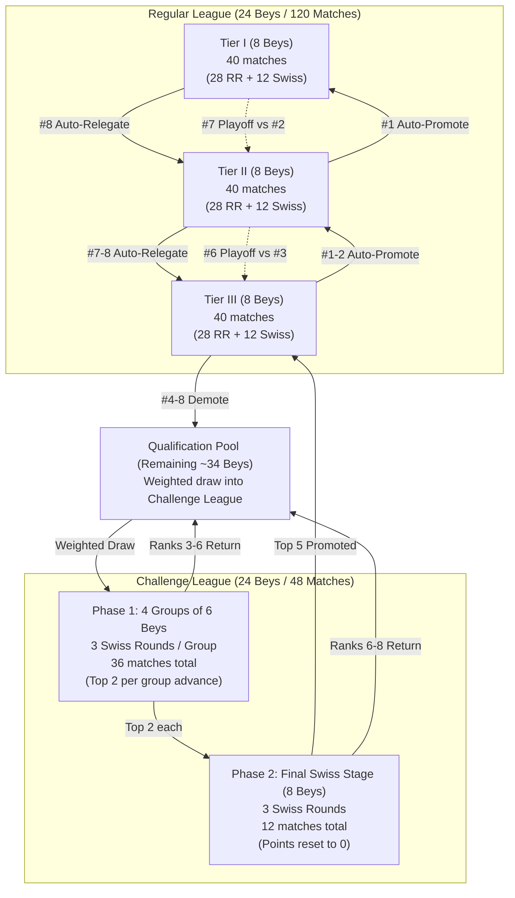

# 🏆 Beyblade X League Season Lifecycle Guide
## Complete Operations Manual: Before, During, and After a Season

This guide outlines the standard operating procedures (SOP) for managing a competitive season in the Beyblade X Elo System, updated for the **Season 4+ League Structure** (3 Regular Tiers of 8 Beys + 24-Bey Challenge League + Qualification Pool).

---

## 📋 Table of Contents
- [🏆 Beyblade X League Season Lifecycle Guide](#-beyblade-x-league-season-lifecycle-guide)
  - [Complete Operations Manual: Before, During, and After a Season](#complete-operations-manual-before-during-and-after-a-season)
  - [📋 Table of Contents](#-table-of-contents)
  - [1. Season Architecture Overview](#1-season-architecture-overview)
    - [Match Counts \& Rules](#match-counts--rules)
  - [2. Before the Season (Pre-Season Setup)](#2-before-the-season-pre-season-setup)
    - [Step 2.1: Verify State \& Leaderboard](#step-21-verify-state--leaderboard)
    - [Step 2.2: Initialize Season \& Draw Challenge League](#step-22-initialize-season--draw-challenge-league)
      - [Case A: Continuing from Previous Season (e.g. S4 to S5)](#case-a-continuing-from-previous-season-eg-s4-to-s5)
      - [Case B: Redrawing or Adjusting Challenge League Only](#case-b-redrawing-or-adjusting-challenge-league-only)
    - [Step 2.3: Setup Challonge Tournaments](#step-23-setup-challonge-tournaments)
    - [Step 2.4: Prepare Match Recording Sheets](#step-24-prepare-match-recording-sheets)
  - [3. During the Season (Matchdays \& Live Operations)](#3-during-the-season-matchdays--live-operations)
    - [Step 3.1: Match Format \& Quotas](#step-31-match-format--quotas)
    - [Step 3.2: Recording Match Sessions](#step-32-recording-match-sessions)
    - [Step 3.3: Running Incremental Updates](#step-33-running-incremental-updates)
    - [Step 3.4: Transitioning between Phase 1 and Phase 2](#step-34-transitioning-between-phase-1-and-phase-2)
      - [Regular Tiers:](#regular-tiers)
      - [Challenge League:](#challenge-league)
  - [4. After the Season (Playoffs, Archiving \& Rollover)](#4-after-the-season-playoffs-archiving--rollover)
    - [Step 4.1: Finalize Standings \& Identify Promotions/Relegations](#step-41-finalize-standings--identify-promotionsrelegations)
    - [Step 4.2: Play and Record Relegation Playoffs](#step-42-play-and-record-relegation-playoffs)
    - [Step 4.3: Final Pipeline Run \& Season Archive](#step-43-final-pipeline-run--season-archive)
    - [Step 4.4: Roll Over into Next Season](#step-44-roll-over-into-next-season)
  - [5. CLI Command Quick Reference](#5-cli-command-quick-reference)

---

## 1. Season Architecture Overview

From Season 4 onwards, the league consists of **168 matches total**:



### Match Counts & Rules
- **Tiers I–III:** 8 Beys per tier.
  - Phase 1: Single Round Robin (7 matchdays = 28 matches).
  - Phase 2: Swiss Placement (3 rounds = 12 matches).
  - **Points carry over:** Final table combines points from all 10 matches per Bey (40 matches per tier, 120 total).
- **Challenge League:** 24 Beys drawn from Qualification Pool.
  - Phase 1: 4 Groups (A, B, C, D) of 6 Beys. 3 Swiss rounds per group = 36 matches.
  - Phase 2: 8 qualifiers (top 2 from each group). **Points reset to 0**. 3 Swiss rounds = 12 matches.
  - **Promotions:** Top 5 Beys qualify directly for next season's Tier III. Ranks 6–8 return to Qualification Pool.

---

## 2. Before the Season (Pre-Season Setup)

### Step 2.1: Verify State & Leaderboard
Ensure all matches from the previous season are recorded and the current ELO leaderboard is up to date:
```bash
python update.py --skip-plots
```
Check that `docs/data/leaderboard.csv` and `docs/data/season/seasons.json` are valid.

### Step 2.2: Initialize Season & Draw Challenge League

#### Case A: Continuing from Previous Season (e.g. S4 to S5)
Run the initialization script specifying the previous season and drawing the Challenge League:
```bash
python src/season/init_season.py S5 --from-season S4 --draw-challenge-league --seed 42 --group-method snake
```
This automatically:
1. Applies automatic promotions & relegations from S4.
2. Applies relegation playoff results.
3. Promotes the top 5 Challenge League finishers into Tier III.
4. Moves bottom Tier III Beys (#4–8) into the Qualification Pool.
5. Calculates inverse participation weights $(w = \frac{1}{1 + \text{relevant\_matches}})$ for all Qualification Pool Beys.
6. Performs weighted random sampling without replacement to pick 24 Challenge League entrants.
7. Snake-seeds the 24 entrants across Groups A, B, C, and D based on current ELO.
8. Writes configuration to `docs/data/season/seasons.json`.

#### Case B: Redrawing or Adjusting Challenge League Only
If the season tiers are already initialized and you only want to re-run the Challenge League draw (for example, with a different seed):
```bash
python src/season/init_season.py S4 --only-draw --seed 123 --group-method snake
```

### Step 2.3: Setup Challonge Tournaments
For live bracket tracking on Challonge, create tournaments following the standardized naming convention:
- **Tier I:** `S{N}_T1` (e.g., `S4_T1`)
- **Tier II:** `S{N}_T2` (e.g., `S4_T2`)
- **Tier III:** `S{N}_T3` (e.g., `S4_T3`)
- **Challenge League Phase 1:**
  - Group A: `S{N}_CL_GA`
  - Group B: `S{N}_CL_GB`
  - Group C: `S{N}_CL_GC`
  - Group D: `S{N}_CL_GD`
- **Challenge League Phase 2 (created once Phase 1 finishes):**
  - Finals: `S{N}_CL_FINALS`

Add the exact Bey names matching `docs/data/beys/beys.csv` and `seasons.json`.

### Step 2.4: Prepare Match Recording Sheets
Setup Google Sheets or CSV templates using `templates/rounds_template.csv` or session files according to [recording_workflow.md](./recording_workflow.md).

---

## 3. During the Season (Matchdays & Live Operations)

### Step 3.1: Match Format & Quotas
Each Bey match is played first-to-appropriate-points (e.g., first to 7 points in tournament play, or standard 3-point format).

**Regular Tiers Schedule (40 matches per tier):**
1. **Phase 1 (Round Robin):** Matchdays 1 to 7 (28 matches).
2. **Phase 2 (Swiss Placement):** Matchdays 8 to 10 (12 matches: 4 matches per round, paired by current standings).

**Challenge League Schedule (48 matches total):**
1. **Phase 1 (Groups A–D):** Rounds 1 to 3 per group (3 matches/round × 3 rounds = 9 matches per group, 36 matches total).
2. **Phase 2 (Finals):** Rounds 1 to 3 (4 matches/round × 3 rounds = 12 matches).

### Step 3.2: Recording Match Sessions

When recording matches into `docs/data/matches/matches.csv` (or importing via `update_matches.py`), ensure the following metadata is present:

| Column | Example Value | Description |
|---|---|---|
| `MatchID` | `MS4-T1-MD01-01` | Unique Match Identifier |
| `Date` | `2026-10-25` | YYYY-MM-DD format |
| `BeyA` | `DranBuster` | First Beyblade name |
| `BeyB` | `WizardRod` | Second Beyblade name |
| `ScoreA` | `7` | Final points Bey A |
| `ScoreB` | `4` | Final points Bey B |
| `MatchType` | `season` / `challenge_group` / `challenge_final` | Match category |
| `SeasonID` | `S4` | Season identifier |
| `Tier` | `1`, `2`, `3`, or `CL` | Tier number or `CL` |
| `Matchday` | `1` | Matchday or round number |

> [!IMPORTANT]
> Use the exact `MatchType` strings:
> - `season`: Regular Tier I, II, III matches.
> - `challenge_group`: Challenge League Phase 1 group matches.
> - `challenge_final`: Challenge League Phase 2 final Swiss matches.
> - `relegation`: End-of-season promotion/relegation playoff matches.

### Step 3.3: Running Incremental Updates
After completing a matchday or session:
1. Import session files:
   ```bash
   python tools/update_matches.py
   ```
2. Run incremental system update:
   ```bash
   python update.py --skip-plots
   ```
   *(Run `python update.py` without `--skip-plots` whenever you want to refresh all visual plots and charts).*
3. Open `docs/season.html` in your browser to inspect updated tables, standings, and badges.

### Step 3.4: Transitioning between Phase 1 and Phase 2

#### Regular Tiers:
- When Round Robin finishes (Matchday 7), sort standings.
- Pair Swiss Round 1 (Matchday 8): #1 vs #2, #3 vs #4, #5 vs #6, #7 vs #8.
- Pair subsequent Swiss rounds based on cumulative points without rematches.

#### Challenge League:
- When all 4 groups complete their 3 Swiss rounds, the system identifies the top 2 Beys from each group.
- The 8 qualifiers are seeded into `S{N}_CL_FINALS`.
- **Reset points to 0** for the final stage.
- Play 3 Swiss rounds among the 8 finalists.

---

## 4. After the Season (Playoffs, Archiving & Rollover)

### Step 4.1: Finalize Standings & Identify Promotions/Relegations
Once all 120 regular matches and 48 Challenge League matches are recorded, inspect the final standings:

- **Tier I:**
  - Ranks 1–6: Retained in Tier I.
  - Rank 7: Enters Relegation Playoff against Tier II #2.
  - Rank 8: Automatically relegated to Tier II.
- **Tier II:**
  - Rank 1: Automatically promoted to Tier I.
  - Rank 2: Enters Promotion Playoff against Tier I #7.
  - Ranks 3–5: Retained in Tier II.
  - Rank 6: Enters Relegation Playoff against Tier III #3.
  - Ranks 7–8: Automatically relegated to Tier III.
- **Tier III:**
  - Ranks 1–2: Automatically promoted to Tier II.
  - Rank 3: Enters Promotion Playoff against Tier II #6.
  - Ranks 4–8: Demoted to Qualification Pool.
- **Challenge League Final:**
  - Ranks 1–5: Promoted to Tier III for next season.
  - Ranks 6–8: Return to Qualification Pool.

### Step 4.2: Play and Record Relegation Playoffs
Two decisive playoff matches must be played:
1. **Playoff 1:** Tier I (Rank 7) vs. Tier II (Rank 2)
2. **Playoff 2:** Tier II (Rank 6) vs. Tier III (Rank 3)

Record these matches in `docs/data/matches/matches.csv` with:
- `MatchType`: `relegation`
- `MatchID`: `M{SEASON}-PLAYOFF-T1T2` and `M{SEASON}-PLAYOFF-T2T3`
- Winner retains/earns the higher tier spot; loser takes the lower tier spot.

### Step 4.3: Final Pipeline Run & Season Archive
Run the complete pipeline to bake the season standings and promotion/relegation records into `docs/data/season/season_data.json`:
```bash
python update.py
```
Verify that the `season_data.json` archive includes:
- Final tables for all 3 tiers.
- `challenge_league` results (groups, finalists, promoted_to_tier3).
- `promotion_relegation` resolution with all playoff winners and losers.

### Step 4.4: Roll Over into Next Season
Initialize the upcoming season (e.g. `S5`) using the archived results:
```bash
python src/season/init_season.py S5 --from-season S4 --draw-challenge-league --seed 42 --group-method snake
```
Verify the newly created season in `docs/data/season/seasons.json`:
- [ ] Tier I has exactly 8 Beys.
- [ ] Tier II has exactly 8 Beys.
- [ ] Tier III has exactly 8 Beys (including the 5 Challenge League qualifiers).
- [ ] Qualification Pool has remaining Beys (expected ~34).
- [ ] Challenge League has 24 newly selected Beys divided into Groups A–D.

Commit and push your changes:
```bash
git add docs/data/
git commit -m "chore(season): finalize S4 and initialize S5"
git push origin feat-new-s4-structure
```

---

## 5. CLI Command Quick Reference

| Action | Command |
|---|---|
| **Initialize Season from Scratch** | `python src/season/init_season.py S4` |
| **Initialize Season from Prior Season** | `python src/season/init_season.py S5 --from-season S4 --draw-challenge-league --seed 42` |
| **Redraw Challenge League Only** | `python src/season/init_season.py S4 --only-draw --seed 123` |
| **Generate CSV Schedule Templates** | `python src/season/init_season.py S4 --generate-schedule` |
| **Import Match Session** | `python tools/update_matches.py` |
| **Fast Pipeline Update (no plots)** | `python update.py --skip-plots` |
| **Full Pipeline Update (all plots)** | `python update.py` |
| **Sync Challonge Fixtures** | `python src/season/challonge_fixtures.py --sync-all` |
| **Run Test Suite** | `pytest` |
